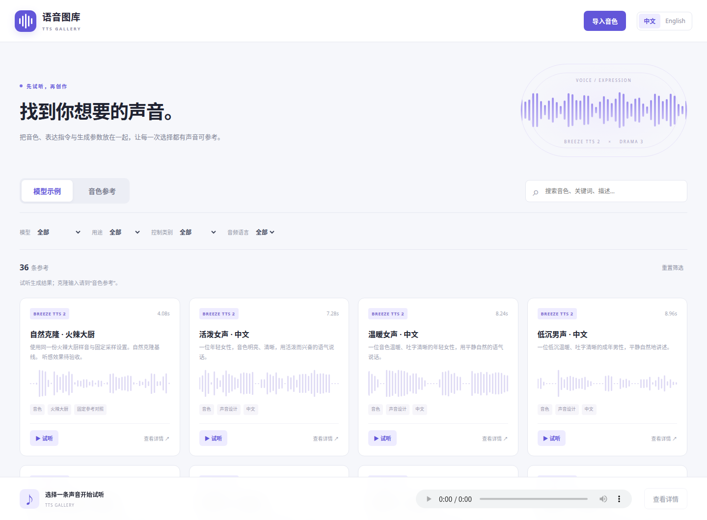

# comfyui-tts-gallery

ComfyUI 本地语音示例与音色参考图库。**36 条可试听模型示例、1 条可克隆音色参考**，音频随插件提供，离线可用。首批支持 **Breeze TTS 2、Drama 3**。



## 安装与入口

将整个 `comfyui-tts-gallery` 文件夹放入 `ComfyUI/custom_nodes/`，重启 ComfyUI 并刷新网页。依赖为 ComfyUI 已使用的 `aiohttp`、`av`、`numpy`、`torch`，无前端构建步骤。浏览和参考节点不加载 TTS 权重；生成需要另行安装对应的 [Breeze 节点](https://github.com/Saganaki22/ComfyUI-Breeze-TTS-2) 或 [Drama3 节点](https://github.com/PedroMarinhoDev/ComfyUI-Drama3) 及模型。

- 顶部工具栏 **语音图库**：直接浏览、试听和打开示例工作流。
- 节点分类 **audio → TTS Gallery**：添加 **TTS 模型示例** 或 **TTS 音色参考**，点击浏览按钮。
- 独立页面：[本机语音图库](http://127.0.0.1:8188/tts_gallery/gallery)。使用其他服务器地址时，在其地址后添加 `/tts_gallery/gallery`。

两个分区可按模型、用途、控制类别、语言、声音标签和来源筛选，支持关键词搜索及中英界面切换。多个搜索词需要全部匹配。音频文案和模型指令保留原文，不随界面语言翻译。

卡片试听使用同一个播放器，详情可以复制文案、指令及实际参数，下载原始音频。卡片波形由真实音频提取。只有从节点打开图库后，**使用此参考 → ComfyUI** 才会写回发起浏览的节点；独立页面可以下载工作流或在新的浏览器标签页打开 ComfyUI。所有浏览、选择、上传操作均不会自动排队。

## 两类节点

| 节点 | 输出 |
| --- | --- |
| `TTSExampleGallery` | `preview_audio: AUDIO`、`example_text: STRING`、`instruction: STRING`、`parameters_json: STRING`、`description: STRING` |
| `TTSVoiceGallery` | `reference_audio: AUDIO`、`reference_text: STRING`、`description: STRING` |

模型示例输出的是**生成结果**，用于试听和查询；音色参考输出的是**克隆输入**及其逐字稿。不要把示例结果当成该示例生成时的原始参考。两个节点检查条目类型、文件与解码错误，不用静音替代丢失素材。

选择编号和界面语言随工作流保存；音色编辑后的逐字稿与描述会在下次执行时更新。输出音频为 ComfyUI 原生字典：`waveform` 为 float32 `[1, channels, samples]`，`sample_rate` 为原始采样率。

## 示例与工作流

| 内容 | 数量 |
| --- | ---: |
| Breeze 已有声音设计预设（中英） | 6 |
| Breeze 已有非语言发声与基线（中英） | 10 |
| Breeze 已有文本内容示例 | 5 |
| Breeze 火辣大厨克隆与表达控制 | 7 |
| Drama3 火辣大厨克隆与标签控制 | 8 |
| 冻结克隆参考：火辣大厨 | 1 |

已有本地 Breeze 的 698 条运行记录经过全量盘点，目录包含其声音设计、发声事件和文本内容示例；性能测试、重复诊断和其他私人参考不作为预设导入。上游 Breeze 附带的4条英文参考不加入首批音色库。完整纳入／排除记录见 `library/SOURCE.json`。

新增15条示例复用同一份火辣大厨参考，各模型内部固定基础采样参数，涵盖自然克隆、情绪、慢速、音量、耳语、笑声、局部控制和组合。首批不声明模型存在固定音色编号：Breeze 声音设计通过描述生成声音，Drama3 的特色声线通过参考音频克隆。

**打开示例工作流**会把当前条目的完整配置载入新的工作流标签页，保留当前工作流。文案、参考音色、种子、温度和指令强度集中在最左侧；高级参数保留在生成节点。换示例时重新打开完整工作流，单独切换参考节点不会自动改写生成节点的参数。

五个可直接导入的 UI 工作流及同名 API 版本位于 `example_workflows/`：

- `breeze_design.json`：声音描述设计。
- `breeze_clone.json`：参考音频与逐字稿克隆。
- `breeze_direction.json`：参考音色加表达指令。
- `drama3_clone.json`：参考音色 → 编码 → 生成 → 解码。
- `drama3_tags.json`：局部标签示例。

输出保存在 `ComfyUI/output/audio/breeze-tts-2/tts-gallery/` 或 `audio/drama3/tts-gallery/`，仅保存最终 FLAC。模型文件缺失时按对应节点的提示安装，不自动下载、替换模型或重启服务。

火辣大厨参考是用户已有的合成成年男声，冻结样音 **8.48秒、24 kHz、单声道**；SHA-256 为 `29c7b2b6deded123a21a0f5115830056dee3e40cfc858c01c5502069fb82c9b2`。日常复用克隆，不按原描述重新设计。

## 自定义音色

点击 **导入音色**，上传 WAV、FLAC 或 MP3，填写名称、语言、准确逐字稿、描述和标签。最大 **25 MiB、60秒、8声道、8–192 kHz**。实际解码检查格式；保留原文件，另生成浏览器可播放的单声道 PCM WAV 试听副本，不做降噪、音色处理或自动转写。

可在详情编辑名称、逐字稿、描述和标签，或删除自定义条目及音频。删除前提示；已引用被删除编号的工作流会明确报错。内置素材只读。并发编辑使用条目修订号，过期修改返回409，不覆盖更新后的数据。

用户数据保存在 **`ComfyUI/user/tts_gallery/`**：

```text
data/custom.json       # 原子替换的用户目录
audio/u-<uuid>.<ext>    # 原始参考音频
preview/u-<uuid>.wav    # 浏览器试听副本
```

可用 `COMFYUI_TTS_GALLERY_USER_LIBRARY` 指定其他持久化目录。升级插件不覆盖用户库，备份时请单独备份。与现有图库一样，同一 ComfyUI 服务的客户端共享该库。

## 验证状态

目录将**执行、文字完整性、听感**分开记录。解码或执行通过不等于听感验收。新增15条已完成实际生成和ASR辅助核对；两条存在“你好／您好”的识别差异，详情已标注。所有示例的人工听感状态保留为未验收，不以ASR结果推断音色相似度或关键词效果。

本机验证环境：ComfyUI 0.43.0、前端1.57.4、RTX 5090 D；Breeze INT8 hybrid / BF16 / SDPA / cuda_graphs；Drama3 FP8 experts in RAM。固定种子用于对照，不承诺跨版本逐位复现。

开发检查：

```bash
python -m unittest discover -s tests -v
node --test tests/test_frontend.mjs
```

需要已安装上述依赖的 Python 环境。`tests/serve_preview.py` 提供隔离预览；用户库位于被忽略的 `.generation/preview-user`。`scripts/build_catalog.py` 从原始运行记录重建素材；`scripts/export_examples.py` 导出共享工作流。生成与ASR核对脚本仅用于开发验收，不由图库界面调用。

## 接口

| 请求 | 用途 |
| --- | --- |
| `GET /tts_gallery/catalog` | 返回目录、可用状态及用户库修订号 |
| `GET /tts_gallery/audio/{id}/original` | 原始音频，支持Range |
| `GET /tts_gallery/audio/{id}/preview` | WAV试听副本，支持Range |
| `GET /tts_gallery/workflow/{id}` | UI工作流；`format=api` 导出API格式，`model=breeze/drama3` 选择音色克隆模型，`download=1` 下载 |
| `POST /tts_gallery/voices` | multipart：`audio`文件与`metadata` JSON字符串 |
| `PATCH /tts_gallery/voices/{id}` | JSON完整可编辑元数据及当前`revision` |
| `DELETE /tts_gallery/voices/{id}` | JSON：`{"revision": 当前修订号}` |

元数据字段为 `name_zh`、`name_en`、`reference_text`、`description_zh`、`description_en`、`language`（zh/en/other）及`tags`字符串数组。名称至少填一种；未填写译名时显示已有名称。写接口拒绝跨来源操作，文件仅按登记ID读取，拒绝越界路径与符号链接。

代码、素材来源与许可分别见 [NOTICE.md](NOTICE.md)、`licenses/` 和模型上游页面；插件代码许可不改变模型或音频的原有许可。
